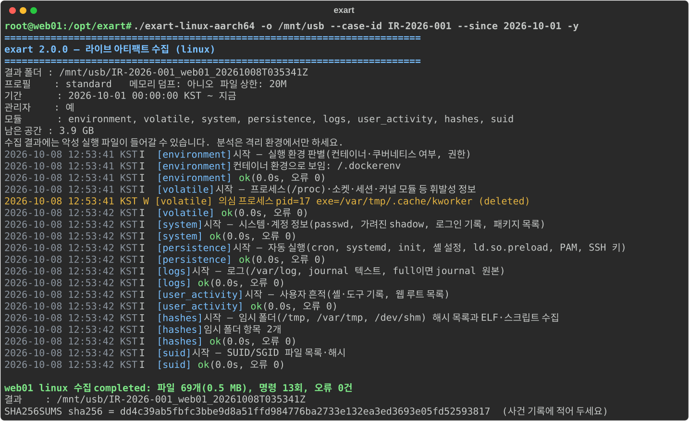
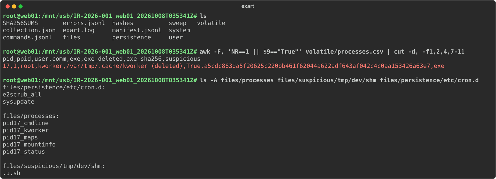
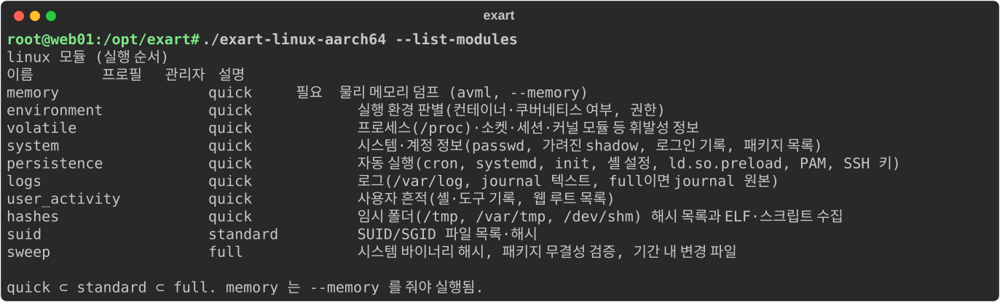
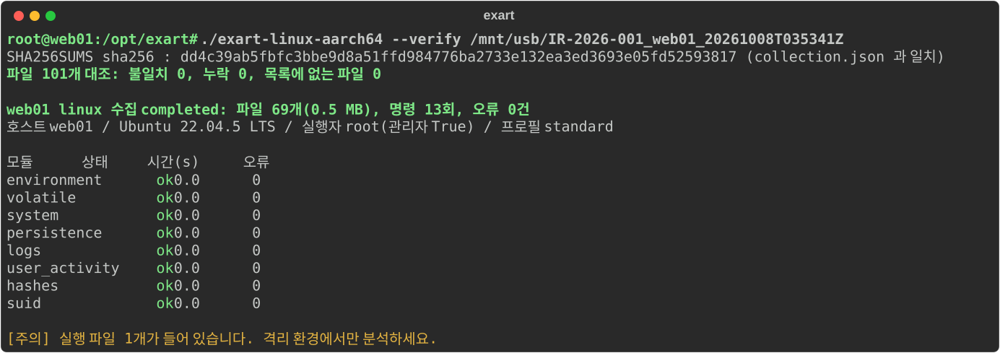

# exart 2 — 사고 대응 라이브 수집기

침해가 의심되는 시스템에서 **켜진 상태 그대로** 아티팩트를 모으는 도구다. Windows, macOS, Linux(컨테이너 포함)를 지원한다.
표준 라이브러리만 쓰므로(Python 3.6 이상) 대상에 패키지를 설치하지 않아도 된다.

## 빠른 사용

```sh
# 대상 시스템에서, 관리자(root) 권한으로. 결과는 외부 저장 장치에 쓴다.
python3 -m exart -o /Volumes/IR_USB --case-id IR-2026-003 --since 2026-10-01

python3 -m exart --list-modules            # 이 OS의 모듈 목록
python3 -m exart --list-modules --os windows
python3 -m exart -o E:\cases --profile quick -y           # 휘발성·핵심만 빠르게
python3 -m exart -o E:\cases --profile full --memory      # 전체 + 메모리 덤프
python3 -m exart -o /mnt/usb --modules volatile,persistence  # 원하는 모듈만
```

| 옵션 | 뜻 |
|---|---|
| `-o` | 결과 상위 폴더(필수). 그 아래 `<사건ID>_<호스트>_<UTC시각>/`이 생긴다 |
| `--profile` | `quick` ⊂ `standard`(기본) ⊂ `full` |
| `--since/--until` | 조사 기간. 시간대 없이 쓰면 KST, 끝에 `Z`를 붙이면 UTC. 로그 조회와 `full`의 기간 내 파일 수집에 쓴다. 없으면 로그는 `--days`(기본 30일) |
| `--memory` | 메모리 덤프(Windows winpmem_mini, Linux avml — `tools/<os>/`에 포함) |
| `--max-file-size` | 파일 하나 복사 상한(기본 20M). 레지스트리·이벤트 로그처럼 꼭 필요한 것은 상한 없이 복사 |
| `--fs-root` | (Linux) 대상 파일시스템 루트. 아래 "쿠버네티스" 참고 |
| `--allow-same-volume` | 시스템 디스크에 결과를 써도 진행(기본은 경고 후 중단) |
| `--dry-run` | 복사·실행 없이 계획만 기록 |
| `--zip` | 끝나면 zip으로 묶고 해시 출력 |

### 실행 화면

아래 화면은 데모용 Linux 컨테이너(`web01`)에서 찍었다. 실행 파일을 지운 채 돌고 있는 가짜 채굴기(`/var/tmp/.cache/kworker`),
`/dev/shm`의 내려받기 스크립트, 이를 부르는 cron 항목을 미리 심어 두었다. 결과는 USB 역할을 하는 별도 볼륨 `/mnt/usb`에 쓴다.



## 결과 폴더

```
IR-2026-003_host_20261008T001411Z/
  collection.json    사건 ID, 호스트, 실행자, 옵션, 모듈별 결과, 통계, 무결성 정보 (schema ir.exart.collection.v1)
  manifest.jsonl     복사한 파일마다: 원본 경로, 원본 시간(mtime/atime/ctime/birth, UTC), 크기, SHA-256, MD5, 종류(pe/elf/macho/script)
  commands.jsonl     실행한 명령마다: argv, 종료 코드, 시간, 출력 파일 SHA-256
  errors.jsonl       실패 항목
  exart.log          진행 로그(UTC)
  SHA256SUMS         결과 폴더 전체 해시. 이 파일의 해시가 콘솔에 나오니 사건 기록에 적는다
  scripts/           (Windows) 실행한 PowerShell 원문
  files/<분류>/<원본 경로>   복사한 원본 파일 (C:\a\b → files/x/C/a/b)
  volatile/ system/ persistence/ ...   명령 출력·생성 CSV
```

저장 시각은 UTC, 화면 표시는 KST다.

위 실행의 결과 폴더다. 지워진 실행 파일은 `/proc/<pid>/exe`에서 원본을 건졌고(`files/processes/pid<PID>_kworker`),
`/dev/shm` 스크립트와 cron 항목도 수집됐다.



**결과물에는 악성 실행 파일이 들어갈 수 있다**(임시 폴더의 ELF/PE, 삭제된 채 실행 중인 프로세스 원본, 서명 없는 이미지).
분석용 PC에서 그대로 풀거나 실행하지 말고 격리 환경(가상 머신, 네트워크를 끊은 샌드박스 등)에서 다룬다.
`collection.json`의 `contains_executables`가 참이면 특히 주의한다.

## OS별로 모으는 것

모듈별 정확한 목록은 `--list-modules`로 본다. 순서는 휘발성이 높은 것부터다.



**Windows** (`exart/windows.py`)
- 휘발성: 프로세스(명령줄·부모·소유자), TCP/UDP 연결과 프로세스, DNS 캐시, ARP·라우팅, SMB 세션, BITS 작업, 로그온 사용자
- 프로세스 이미지: 실행 중 EXE·로드된 DLL의 Authenticode 서명 확인, 서명이 유효하지 않은 파일 수집
- 지속성: 서비스, 드라이버, 예약 작업(목록+Tasks 폴더), Run 키 등 자동 실행 레지스트리(전체 사용자 하이브), IFEO, WMI 이벤트 구독, 시작 프로그램, GPO 스크립트, (있으면) autorunsc
- 이벤트 로그: 주요 채널(standard부터는 비어 있지 않은 전체 채널) evtx, 로그온·계정 변경·로그 삭제·서비스 설치·RDP·PowerShell 4104·Defender 등 주제별 텍스트 추출
- 레지스트리: SAM/SECURITY/SYSTEM/SOFTWARE(reg save), 사용자별 NTUSER.DAT·UsrClass.dat
- 실행 흔적: Prefetch, Amcache, PCA, SRUM, ShimCache
- 사용자: PowerShell 기록, 최근 파일·점프 목록, 휴지통 $I, WebCache, 아이콘·썸네일 캐시, Timeline
- 브라우저: Chrome/Edge/Brave/Whale/Firefox 기록·북마크·확장(쿠키·저장 비밀번호는 모으지 않음)
- NTFS: $MFT, UsnJrnl(fsutil 파싱본), full이면 $LogFile·$J 원본
- 해시: Temp·시작 메뉴·Public·Downloads·ProgramData. full이면 웹셸·스크립트 탐색, System32 해시, 기간 내 변경 파일

잠긴 파일은 일반 복사 → `esentutl /y /vss`(볼륨 섀도 사본 임시 생성) → `forecopy -f` 순서로 시도한다.

**macOS** (`exart/macos.py`)
- 휘발성: ps, lsof, netstat, DNS·프록시, launchctl, 커널·시스템 확장
- 프로세스 이미지: 실행 파일 해시·codesign(미서명·adhoc는 수집)
- 시스템: SIP, Gatekeeper, FileVault, 구성 프로파일, 관리자 그룹, 원격 로그인, 설치 기록
- 지속성: LaunchAgents/Daemons(plist 해석·프로그램 서명 요약 CSV), 로그인 항목·BTM, cron, periodic, 인가 플러그인, PrivilegedHelperTools, 셸 설정, SSH 키
- 로그: 통합 로그(인증, Gatekeeper/XProtect, 설치, 백그라운드 작업) ndjson, /var/log, 감사 로그, full이면 `log collect` 원본
- 사용자: 셸 기록, 다운로드 격리 기록(QuarantineEventsV2), 최근 항목, TCC.db, KnowledgeC
- 브라우저: Safari/Chrome 계열/Firefox

TCC 보호 영역은 터미널에 **전체 디스크 접근 권한**이 있어야 읽힌다. 없으면 경고를 남기고 계속 진행한다.

**Linux** (`exart/linux.py`)
- 환경 판별: 컨테이너·쿠버네티스 여부, 권한(capabilities)
- 휘발성: `/proc`를 직접 읽어 프로세스·소켓 목록을 만든다(ps·ss가 없는 컨테이너에서도 동작). **실행 파일이 지워진 채 돌거나 /tmp·/dev/shm·memfd에서 실행된 프로세스는 `/proc/<pid>/exe`로 원본을 건진다**
- 시스템: passwd/group, shadow(해시는 가리고 알고리즘·잠금 여부만), wtmp/btmp, 패키지 목록(dpkg/apk/rpm)
- 지속성: cron(+Alpine `/etc/crontabs`), systemd(사용자 유닛 포함), init, rc.local, 셸 설정, `ld.so.preload`, PAM, sshd 설정, udev, autostart, SSH 키
- 로그: /var/log, journal 텍스트(full이면 원본)
- 해시: /tmp, /var/tmp, /dev/shm 목록과 ELF·스크립트 수집, SUID/SGID, full이면 시스템 바이너리 해시와 `dpkg --verify`/`rpm -Va`

### 쿠버네티스 Pod (셸·파이썬이 없는 컨테이너)

대상 컨테이너에 파이썬이 없으면 디버그 컨테이너를 붙여 PID 네임스페이스를 공유한다.

```sh
kubectl debug -it <pod> -n <ns> --image=python:3.12-slim --target=<컨테이너> -- bash
# 디버그 컨테이너 안에서: exart 복사 후 대상 프로세스 PID 확인(보통 1)
python3 -m exart -o /tmp/ir --fs-root /proc/1/root --case-id IR-xxx -y --allow-same-volume
# 밖에서 회수
kubectl cp <ns>/<pod>:/tmp/ir ./ir -c <디버그 컨테이너 이름>
```

프로세스·소켓은 공유된 네임스페이스에서, 파일은 `--fs-root` 아래에서 읽는다. 패키지·systemd·journal 명령은
디버그 컨테이너 것이므로 이 모드에서는 건너뛴다. Pod를 지우기 전에 수집한다.

## 단일 실행 파일 (대상에 파이썬이 없을 때)

대상에 Python 3.6 이상이 있으면 빌드할 필요가 없다. 저장소 폴더를 외부 저장 장치에 복사하고 `python3 exart_run.py`로 실행한다.
파이썬이 없는 대상(Windows, 최소 설치 Linux 등)에 가져갈 때만 `dist/`에 OS별 배포 폴더를 빌드한다(Git 제외).

압축을 풀지 않는 onedir 형식이다. onefile 실행 파일은 실행할 때마다 대상의 임시 폴더에 런타임을 풀어 대상 디스크에 흔적을 남긴다.
실행 파일은 같은 폴더의 `tools/<os>/`에서 외부 도구를 찾으므로 **배포 폴더를 통째로**(실행 파일, `_internal/`, `tools/`) 옮긴다.

| 파일 | 대상 | 빌드 환경 |
|---|---|---|
| `exart-windows-x64.exe` | Windows 7 SP1 이상 x64 (Python 3.8 기반) | Docker+Wine, 또는 Windows |
| `exart-macos-arm64` | Apple Silicon Mac | Apple Silicon Mac |
| `exart-linux-x86_64`, `exart-linux-aarch64` | glibc 2.31 이상(Ubuntu 20.04+, Debian 11+, RHEL 9+) | Docker `python:3.8-slim-bullseye` |

### 빌드

교차 빌드는 안 되므로 각 OS·아키텍처(또는 해당 플랫폼 Docker)에서 빌드한다. 저장소 루트에서 실행하며, 빌드마다 PyInstaller 6.11.1을 받으므로 인터넷이 필요하다.

```sh
# Windows x64 (macOS·Linux에서 Docker + Wine)
sh packaging/build_windows_docker.sh

# macOS arm64 (Mac에서 직접)
sh packaging/build_posix.sh

# Linux x86_64 (aarch64는 --platform linux/arm64)
docker run --rm --platform linux/amd64 -v $PWD:/src:ro -v $PWD/dist:/dist python:3.8-slim-bullseye \
  sh -c 'apt-get update -qq && apt-get install -y -qq binutils && sh /src/packaging/build_posix.sh /dist'
```

Windows에서 직접 빌드할 때는 `powershell -ExecutionPolicy Bypass -File packaging\build_windows.ps1`(Python 3.8 권장, 3.9 이상은 Windows 7 미지원).

스크립트는 끝에 `--version`을 실행해 보고 압축 파일·실행 파일의 SHA-256을 출력한다. **이 값을 기록해 두고 현장에서 대조한다.**
`tools/<os>/`의 외부 도구는 빌드할 때 배포 폴더로 복사되므로, 코드나 도구를 바꾸면 다시 빌드한다.
결과물 구조, 빌드 뒤 확인, 문제 해결은 `docs/BUILD.md`에 있다.

실행 파일이 맞지 않는 시스템(glibc가 더 오래된 RHEL 7·8, musl 기반 Alpine, Intel Mac)은 `python3 exart_run.py`로 소스를 직접 실행한다.
RHEL 8에는 `/usr/libexec/platform-python`(3.6)이 기본으로 있다.

## 외부 도구

exart는 대부분을 OS 내장 명령으로 수집하고, 아래 도구는 **있으면 쓰고 없으면 건너뛴다**.
라이선스 때문에 저장소에 넣지 않으니 배포처에서 받아 `tools/<os>/`에 둔다. 파일 이름, 검증한 SHA-256, 서명 정보는 각 폴더의 README에 있다
([windows](tools/windows/README.md), [linux](tools/linux/README.md), [macos](tools/macos/README.md)).

| OS | 도구 | 쓰는 모듈 | 받는 곳 |
|---|---|---|---|
| Windows | WinPmem mini v4.0.rc1 | memory | https://github.com/Velocidex/WinPmem/releases/tag/v4.0.rc1 |
| Windows | Sysinternals Autoruns (autorunsc) | persistence | https://learn.microsoft.com/sysinternals/downloads/autoruns |
| Windows | The Sleuth Kit (icat, fls) | ntfs | https://www.sleuthkit.org/sleuthkit/download.php |
| Windows | forecopy_handy | ntfs, 잠긴 파일 | 공식 배포처 없음. `tools/windows/README.md`의 SHA-256과 대조 |
| Windows | ShimCacheParser | execution | https://github.com/mandiant/ShimCacheParser (실행 파일로 빌드해서 사용) |
| Windows | NirSoft BrowsingHistoryView, ChromeCacheView, IECacheView, MozillaCacheView, ExecutedProgramsList | browsers, execution | https://www.nirsoft.net/utils/browsing_history_view.html 외 ([목록](tools/windows/README.md)) |
| Linux | Microsoft AVML v0.20.0 | memory | https://github.com/microsoft/avml/releases/tag/v0.20.0 |
| macOS | 없음 | — | — |

받은 뒤 SHA-256을 대조하고, Windows 도구는 `Get-AuthenticodeSignature`로 서명을 확인한다. 빌드할 때 `tools/<os>/`가 배포 폴더로 복사된다.

## 결과 검증

```sh
exart --verify <결과폴더>     # SHA256SUMS 대조, 모듈별 상태·오류 요약
```

증거를 넘겨받았을 때와 새 환경에서 처음 돌린 뒤에 쓴다. 해시가 하나라도 다르거나 파일이 빠지거나 더해졌으면 종료 코드 1이다.



## 운영 원칙

- **결과는 외부 저장 장치에 쓴다.** 대상 디스크에 쓰면 삭제된 파일 흔적(미할당 영역)을 덮어쓴다. 시스템 볼륨이면 경고 후 멈춘다.
- **대상 시스템을 바꾸는 동작은 최소화했다.** 모니터링 에이전트 설치 같은 변경은 하지 않는다. 남는 변경: 잠긴 파일을 forecopy로 못 읽을 때의 `esentutl /vss`(임시 섀도 사본), PowerShell 스크립트 실행 기록, 도구 실행에 따른 Prefetch 생성.
- **클라우드 동기화 파일은 읽지 않는다.** OneDrive 온라인 전용 파일과 iCloud dataless 파일은 읽는 순간 내려받기가 일어나므로 목록에만 남긴다(`cloud_placeholder`).
- **외부로 아무것도 보내지 않는다.** VirusTotal 같은 온라인 조회는 하지 않는다. 해시 조회는 수집이 끝난 뒤 분석 환경에서 한다.
- EDR이 수집 동작(레지스트리 하이브 저장, 메모리 덤프 등)을 탐지할 수 있다. 보안 운영 쪽에 미리 알린다.

## 개발

```sh
python3 -m unittest discover -s tests      # 단위 테스트
python3 -m exart --verify <결과폴더>
python3 -m exart --list-modules --os linux
```

새 아티팩트는 해당 OS 파일에 `@module(OS, 이름, 설명, level=, order=)` 함수로 추가한다. 파일 복사는 반드시
`ctx.copy`/`ctx.copy_tree`, 명령은 `ctx.run`을 써야 manifest·commands 기록과 해시가 남는다.
Python 3.6 문법을 지킨다(dataclass, `:=`, `capture_output` 금지).

변경 내역: `CHANGELOG.md`. 빌드: `docs/BUILD.md`. Windows 실기 점검 절차: `docs/WINDOWS_TEST.md`.

## 라이선스

exart 코드는 MIT 라이선스다(`LICENSE`). `tools/` 아래 외부 도구는 각 배포처의 라이선스를 따르며 이 저장소에 포함하지 않는다.
